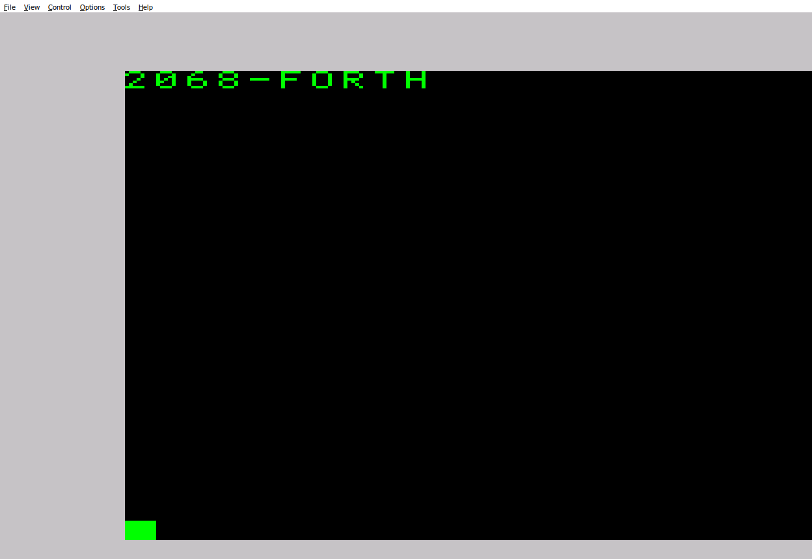
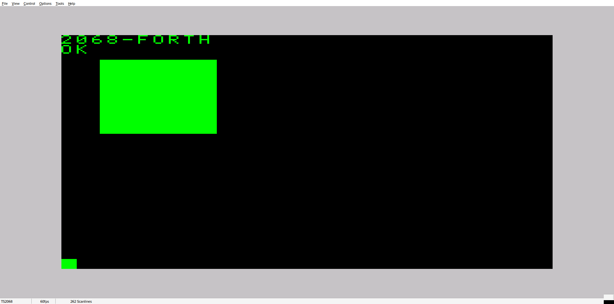

# EightyOne setup

EightyOne 1.41 runs the HOME ROM from its **ROM File** setting and the graphics EXROM as a **Timex ROM cartridge**
(`graphics_exrom.dck`). Without the cartridge everything works except `EDIT`, `FILL`, `CIRCLE`, `RECT`, `POLYGON`,
`POLYGON-FILL` and the `SPRITE` words, which report `NO EXROM`.

The convention (HOME ROM via ROM File, EXROM wrapped as a `.dck` with the 9-byte header below) comes from EightyOne's
own developer. TS-Pico is covered in [`ts_pico_setup.md`](ts_pico_setup.md).

## Build the files

```sh
make
```

This writes, among others:

- `build/forth_boot_rom0.bin`: the 16 KB HOME ROM.
- `build/graphics_exrom.dck`: the 8 KB EXROM (`build/graphics_exrom.bin`) as an EightyOne Timex cartridge, made by
  `tools/make_dck.sh`.

Both are also in the release zip. See [CONTRIBUTING.md](../CONTRIBUTING.md) for the prerequisites.

EightyOne does not load a raw EXROM binary as a cartridge. The `.dck` file is the raw EXROM preceded by these nine
bytes:

```text
FE 00 00 00 00 00 02 00 00
```

Bank id `$FE` is the EXROM bank, followed by one presence-flag byte per chunk 0-7 in order. Chunk 5 (`$A000-$BFFF`),
where `kernel/bank/bank.asm` pages the EXROM in, is marked `$02` (ROM present); every other chunk is `$00`.
`tools/make_dck.sh` checks that the input is exactly 8192 bytes and the output exactly 8201.

## Configure EightyOne 1.41

1. Select the **Timex** tab and the **TS2068** machine.
2. Under **Advanced Settings**, set **ROM File** to `build/forth_boot_rom0.bin`.
3. Leave **Protect ROM from Writes** enabled.
4. Under **Interfaces**, set **ROM Cartridge** to **Timex** and select `build/graphics_exrom.dck` as the cartridge
   file. Use the `.dck`, not a raw `.bin`.
5. Apply the settings and perform a hard reset.

## Running on Linux via Wine

EightyOne also runs under Wine (`cd ~/EightyOne && wine EightyOne.exe`). The two files above boot to the `2068-FORTH`
banner:



EightyOne keeps its configuration in a plain INI file at
`~/.wine/drive_c/users/<user>/AppData/Roaming/EightyOne/EightyOne.ini`, under `[HARDWARE]`: `ROMTS2068=` and `RomFile=`
for the ROM, `Dock=`, `RomCartridgeFile=`, `SinclairRomCartridgeFile=`, `TS1510RomCartridgeFile=`,
`TC2068RomCartridgeFile=` and `TS2068RomCartridgeFile=` for the cartridge. Editing the INI and relaunching is quicker
than the dialogs when you swap images.

## Recorded findings

- **HOME ROM boot** (`forth_boot_rom0.bin` as ROM File): works, under Wine on Linux and on Windows.
- **Graphics cartridge** (`graphics_exrom.dck`, chunk 5): works. EightyOne's developer, John Stroebel, ran
  `20 20 80 80 RECT` at the `OK` prompt against these two files on 1.41 and sent a screenshot of the solid green block.
  The same test on the Wine install gives the same block:

  

  Earlier runs on 1.41 with an earlier build of the cartridge did not show the EXROM words; why is not established.
- **Other readers of the same `.dck`**: TSRun, run headlessly against the same file, and ZEsarUX and Fuse (which load
  the EXROM by their own means, see the README's "Running it") all give the same result, and TS-Pico's firmware parses
  the same header (bank `$FE`, chunk index per flag byte).

Everything here is checked on emulators only.
