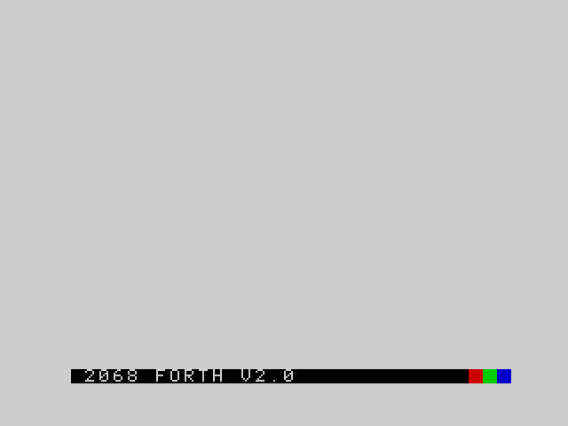
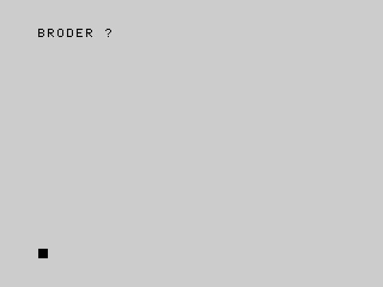
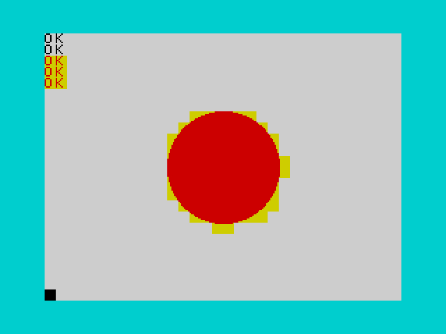

# Part 2 -- Beginner's guide

This part teaches Forth from nothing, one small step at a time. It is for someone who has used a BASIC, perhaps the
one that came with the TS2068, and has never seen Forth. Read it with the machine in front of you (a real one, or an
emulator) and type in every example. Each example in this part has been typed into the ROM by the build, and what you
see on your screen is what the comments say.

Each chapter is short. If you already know Forth, skim Chapters 1 and 4 for the keys and the editor, and read
[Part 3](03_language.md) and [Part 4](04_machine.md), which are the reference.

A few comment lines in the examples are instructions to the build's tests, not to you. `\ expect:` shows what a line
prints (see [How to read this manual](01_introduction.md#how-to-read-this-manual)). `\ draws` marks a line that draws
on the screen, and `\ keys:` and `\ break:` say which keys the test presses for a line that waits for them: when you
type the example, press those keys yourself. Forth skips the rest of a line after `\`, so you can type a line with or
without its comment.

## Chapter 1 -- Switching on

Switch on the machine. A chord plays, and the screen turns white with a black bar at the bottom that reads
`2068 FORTH V2.0.1`:



There is no `READY` and no `OK` yet, and no line numbers. The row at the bottom is the **input line**: the place where
you type. The first key you press takes the version off the bar. Everything above it, rows 0 to 22, is where Forth
prints what your words print.

### Typing a line

Type this, and press ENTER:

```forth
5 3 + .                  \ expect: 8
```

Forth reads the line, runs it, and prints `8` and then `OK`. The line you typed does not appear again: what you see
is what the line printed. `OK` means that the whole line ran without an error. Type `5 3 + .` again and `8 OK` appears
on the row below.

A line may hold as many words as fit in 128 characters. A line that is longer than one row of 32 characters wraps on to
the next, and the input line grows upwards, to at most four rows. Names are not case sensitive: `dup` is `DUP`, and
this manual writes them in capitals.

You need some punctuation that the TS2068 has no keys for. SYMBOL SHIFT with a letter gives it (on a PC, **Ctrl** is
SYMBOL SHIFT and **Shift** is CAPS SHIFT). The ones this guide uses:

| You want | SYMBOL SHIFT and | You want | SYMBOL SHIFT and |
|---|---|---|---|
| `.` | M | `:` | Z |
| `;` | O | `"` | P |
| `(` | 8 | `)` | 9 |
| `\` | D | `,` | N |
| `*` | B | `+` | K |
| `-` | J | `/` | V |
| `<` | R | `>` | T |
| `=` | L | `'` | 7 |

[Appendix B](08_appendices.md#appendix-b-the-character-set-and-keys) has the whole table.

### Correcting a line before ENTER

Forth reads the line only when you press ENTER, so you can change it until then. These keys work on the input line:

| Keys | What they do |
|---|---|
| a character | goes in at the cursor, and what is after it moves along |
| CAPS SHIFT + 5 | moves the cursor left |
| CAPS SHIFT + 8 | moves the cursor right |
| CAPS SHIFT + 0 (DELETE) | deletes the character before the cursor |
| ENTER | runs the line |

The cursor need not be at the end. Type `13`, move left once and type `2`: the line reads `123`. On a PC the arrow keys
and Backspace do the same. The other editing keys belong to `EDIT` (Chapter 4), not to the input line.

### Words and spaces

A Forth line is a row of **words** separated by spaces. A word is any run of characters that is not a space: `5`, `+`,
`.` and `DUP` are all words. Forth reads a word, looks for it among the words it knows, and runs it. If it is not a
word it knows, Forth tries to read it as a number. If it is neither, the line stops with a message (Chapter 4).

The spaces matter. `5 3 +` is three words. `5 3+` is two, and the second is not a word Forth knows.

## Chapter 2 -- The stack

Forth keeps numbers on a **stack**. Think of a pile of index cards. A number you type is written on a card and put on
top of the pile. A word that needs numbers takes them from the top of the pile, and puts its answer back on top.
Only the top of the pile is in reach.

### Putting numbers on, printing them off

Typing a number pushes it. Nothing is printed, because nothing asked for it. The word `.` (say "dot") takes the top
number off the stack and prints it, followed by a space:

```forth
42 .                     \ expect: 42
1 2 3 . . .              \ expect: 3 2 1
```

The numbers come back in the opposite order, because the last one pushed is the first one off. Each `.` removes the
number it prints, so after these lines the stack is empty.

### Arithmetic

Arithmetic words take their numbers from the stack. The numbers come first, then the word that works on them. This
order is called **postfix**:

```forth
5 3 + .                  \ expect: 8
10 11 + 12 + .           \ expect: 33
10 3 - .                 \ expect: 7
3 10 - .                 \ expect: -7
6 7 * .                  \ expect: 42
```

Follow `10 11 + 12 + .` one word at a time. The stack is shown with its top on the right:

```text
you type   stack after
10         10
11         10 11
+          21            takes 10 and 11, leaves their sum
12         21 12
+          33
.                        prints 33, leaves nothing
```

Nothing else is needed: no brackets, and no rules about which operation comes first. They happen in the order you
write them. Where BASIC writes `(5+3)*2`, Forth writes `5 3 + 2 *`.

The order of the numbers is the order you would say them: `10 3 -` is "10 minus 3". Only the operator has moved to the
end.

### Moving numbers about

A word often needs a number that is not on top, or needs it twice. A few words rearrange the stack and do no
arithmetic. The comment after `--` shows the stack before and after (the top is on the right):

| Word | Effect | What it does |
|---|---|---|
| `DUP` | `( n -- n n )` | copies the top number |
| `DROP` | `( n -- )` | throws the top number away |
| `SWAP` | `( a b -- b a )` | swaps the top two |
| `OVER` | `( a b -- a b a )` | copies the second number to the top |
| `ROT` | `( a b c -- b c a )` | moves the third number to the top |

```forth
5 DUP * .                \ expect: 25
1 2 SWAP . .             \ expect: 1 2
1 2 DROP .               \ expect: 1
1 2 OVER . . .           \ expect: 1 2 1
1 2 3 ROT . . .          \ expect: 1 3 2
```

`5 DUP *` is the way to square a number: the copy is made before `*` uses up the two. `ROT` is the hardest to see.
After `1 2 3 ROT` the stack holds 2, 3, 1 with the 1 on top, so the three `.` print 1, then 3, then 2.

The same notation, `( before -- after )`, is used for every word in the reference parts. `+` is `( a b -- sum )`: it
takes two numbers and leaves one. `.` is `( n -- )`: it takes one and leaves none. A number you type is `( -- n )`.

There are a few more of these words: `2DUP` and `2DROP` work on the top pair, `?DUP` copies only a number that is not
zero, and `PICK` copies a number from further down. They are in [Part 3](03_language.md).

### STACK?

The stack holds numbers you have not used yet. If a word asks for more numbers than the stack holds, Forth notices,
prints `STACK?` and empties the stack:

```forth
DROP                     \ expect: STACK?
```

An error stops the line. A line that ends in an error prints its message and no `OK`. The rest of the line is not run.
Chapter 16 says more about errors, and [The stacks](05_concepts.md#the-stacks) says exactly what is checked and when.

## Chapter 3 -- Your own words

A **definition** teaches Forth a new word. It starts with `:` (say "colon"), then the name, then the words the new word
is made of, then `;`:

```forth
: DOUBLE  DUP + ;
4 DOUBLE .               \ expect: 8
```

Typing the definition prints nothing but `OK`. Nothing in it has run: Forth has only written down what `DOUBLE` means.
`DOUBLE` runs when you type it, and `4 DOUBLE .` is `4 DUP + .`. From now on `DOUBLE` is a word like `+` or `DUP`, and
you can use it inside other definitions:

```forth
: DOUBLE  DUP + ;
: QUADRUPLE  DOUBLE DOUBLE ;
3 QUADRUPLE .            \ expect: 12
```

A word can use only words that already exist when it is defined, so define the small pieces first. A name is any run
of characters that is not a space.

A definition can run over several lines. Forth reads each line as you press ENTER and carries on:

```forth
: SHOW
  DUP .
  DUP * . ;
5 SHOW                   \ expect: 5 25
```

### Comments

Forth skips a comment. `\` skips the rest of the line, and `(` skips everything up to the next `)`. Each needs a space
after it, like any word. A comment after the name is the usual place for the stack effect:

```forth
\ the square of a number
: SQUARE ( n -- n*n )  DUP * ;
4 SQUARE .               \ expect: 16
```

### Redefining

You can define a word that already exists. Your new word is found first, and the old one is still there underneath it.
A word that was defined earlier goes on using the old one:

```forth
: ONE  1 ;
: TWO  ONE ONE + ;
: ONE  100 ;
ONE .                    \ expect: 100
TWO .                    \ expect: 2
```

### FORGET

`FORGET` followed by a name removes that word **and every word defined after it**, and gives the memory back:

```forth
: A  1 ;
: B  2 ;
: C  3 ;
FORGET B
C                        \ expect: C ?
A .                      \ expect: 1
```

`B` and `C` are both gone: there is no way to remove `B` alone. The ROM's own words cannot be forgotten, and a name that
is not there is not an error, only a message:

```forth
FORGET DUP               \ expect: FORGET: BUILT-IN, REFUSED
FORGET NOSUCH            \ expect: FORGET: NOT FOUND
```

### What words are there

`VLIST` prints the name of every word Forth knows, newest first: your own words, then the ROM's, back to the oldest.
The list is longer than the screen and does not stop, so what stays on the screen at the end is the oldest words:

```forth
VLIST                    \ expect-end: SWAP DUP DROP
```

`FREE` says how many bytes you have left for new words:

```forth
FREE 16000 >  .          \ expect: -1
```

(`>` is the next chapter's. The `-1` means yes.)

### Words that only work inside a definition

Some words, such as `IF`, `DO` and `."`, only mean something inside a definition. Typed at the prompt, Forth refuses
them:

```forth
IF                       \ expect: IF ?
```

Chapters 8 to 10 use them.

## Chapter 4 -- Correcting mistakes

Everyone makes mistakes. The ROM does not crash on them: it prints a message and gives you the prompt back.

### A word Forth does not know

Type a word Forth cannot find, and cannot read as a number, and it prints that word and a question mark:

```forth
5 BRODER                 \ expect: BRODER ?
```



The word printed is the word Forth stopped at, which is usually the clue. Look first for a missing space: `:DOUBLE`
and `DUP+` are single words, so Forth prints `:DOUBLE ?` and `DUP+ ?`.

```forth
:DOUBLE DUP + ;          \ expect: :DOUBLE ?
: DOUBLE DUP+ ;          \ expect: DUP+ ?
```

An error stops the line and empties both stacks, so the `5` in the first example is gone too. A definition that has an
error in it is not kept: after `: Q NOSUCH ;` there is no word `Q`.

```forth
: Q  NOSUCH ;            \ expect: NOSUCH ?
Q                        \ expect: Q ?
```

### The line store

Every line you press ENTER on is also kept as text, one line each, in order, in the **line store**. It holds 8,192
bytes. An empty line is not kept, and neither is a line that holds `EDIT`, `SAVE-TEXT`, `VERIFY-TEXT` or `LOAD-TEXT`:
those are commands about the store, not part of your program.

`LIST-DEFS` prints the definitions in the store, numbered from 0, oldest first, each with the start of its source (the
first sixteen are shown):

```forth
: SQURE  DUP * ;
5 SQURE .                \ expect: 25
LIST-DEFS                \ expect: 0: : SQURE  DUP * ;
```

### EDIT

`SQURE` works, but the name is wrong. You could type the whole definition again. For a long definition it is easier to
open it in the full-screen editor, with `EDIT` and the name:

```forth
: SQURE  DUP * ;
\ keys: \x04\x04\x04\x04\x04A\x10
EDIT SQURE
5 SQUARE .               \ expect: 25
```

`EDIT SQURE` clears the screen and shows the lines in the store, 23 rows of them. The status row at the bottom reads
`LINE n/m`: the number of the line the cursor is on, and how many lines there are. The cursor starts at the beginning
of the last line that begins `: SQURE`. Press CAPS SHIFT and 8 five times to move it to just after `: SQU`, type `A`,
and press BREAK (CAPS SHIFT and SPACE) to leave. (In the example, `\x04` is the code of the right-arrow key and `\x10`
that of BREAK, which is how the test presses them.)

When you leave, Forth clears the screen and runs the lines you changed or added, in order, as if you had typed them.
Lines you only looked at are not run again. The corrected line defines `SQUARE`.

The editing keys in the view are:

| Keys | What they do |
|---|---|
| characters, CAPS SHIFT + 5, CAPS SHIFT + 8, CAPS SHIFT + 0 | edit the line, as at the prompt |
| CAPS SHIFT + 7, CAPS SHIFT + 6 | move up and down, between the rows of a long line and between lines |
| ENTER | ends this line and opens a new one after it; nothing runs |
| CAPS SHIFT + ENTER | opens an empty line above this one |
| DELETE on an empty line, or CAPS SHIFT + 1 | deletes the line |
| BREAK (CAPS SHIFT + SPACE) | leaves the view and runs the lines you changed |

`EDIT` alone opens the view on a new empty line after the last one, to add something. If `EDIT` is given a name that has
no definition, it prints `NAME ?`. If a line you changed has an error, it stops there: the message begins with the
number of the line, as in `LINE 3 FOO ?`, and the lines after it are not run. The lines stay in the store as you left
them.

The old `SQURE` is still in the dictionary. Editing a definition does not remove the old one: it defines a new one
after it, and the new one is found first. [The editor and the line store](05_concepts.md#the-editor-and-the-line-store)
has the limits and the rest of the messages (`LONG LINE`, `STORE FULL`, `NO EXROM`).

## Chapter 5 -- Numbers

### How big can a number be?

A whole number takes 16 bits. As a signed number it is from -32,768 to 32,767. If a calculation goes past the end,
it **wraps around** to the other end, and Forth does not tell you:

```forth
32767 1 + .              \ expect: -32768
-32768 1 - .             \ expect: 32767
256 256 * .              \ expect: 0
```

You may type a number from -32,768 up to 65,535. A number above 32,767 has the same 16 bits as a negative number,
and prints as one. A number outside that range is refused:

```forth
40000 .                  \ expect: -25536
65536 .                  \ expect: OUT OF RANGE
```

For fractions, and for much larger numbers, Chapter 6 has decimals.

### Division

`/` divides and keeps the whole part, `MOD` gives the remainder. Both cut towards zero, and the remainder takes the
sign of the first number:

```forth
17 5 / .                 \ expect: 3
17 5 MOD .               \ expect: 2
-17 5 / .                \ expect: -3
-17 5 MOD .              \ expect: -2
```

Dividing by zero is not an error: the answer is 0.

```forth
5 0 / .                  \ expect: 0
```

### Sign and size

| Word | Effect | What it does |
|---|---|---|
| `NEGATE` | `( n -- -n )` | changes the sign |
| `ABS` | `( n -- \|n\| )` | drops the sign |
| `MAX` | `( a b -- the larger )` | |
| `MIN` | `( a b -- the smaller )` | |
| `1+` `1-` | `( n -- n+1 )` | add or take 1 |
| `SQRT` | `( n -- root )` | the whole part of the square root |

```forth
-5 ABS .                 \ expect: 5
5 NEGATE .               \ expect: -5
3 7 MAX .                \ expect: 7
3 7 MIN .                \ expect: 3
15 SQRT .                \ expect: 3
```

### Random numbers

`n RND` gives a random whole number from 0 up to, but not including, `n`. `n RANDOMIZE` starts the sequence from a fixed
point, so the same number after `RANDOMIZE` always gives the same sequence. `0 RANDOMIZE` starts it from the machine's
timing, so it is different each time.

```forth
10 RND  10 < .           \ expect: -1
12345 RANDOMIZE
100 RND .                \ expect: 51
```

The first line asks "is the number less than 10?" and the answer is always yes, whatever number came up. After
`12345 RANDOMIZE` the first `100 RND` is always 51.

## Chapter 6 -- Numbers with fractions

A whole number has no fractions: `7 2 /` is 3. A number you write with a `.`, or with an exponent, is a **decimal**.
Decimals have a stack of their own, separate from the stack of whole numbers. Words for decimals have an `F` in front:

```forth
3.5 2.5 F+ F.            \ expect: 6.0000
1.0 4.0 F/ F.            \ expect: 0.2500
2.0 3.0 F+ 4.0 F* F.     \ expect: 20.0000
```

`F.` takes a decimal off the decimal stack and prints it. The other words you know have `F` versions: `F+ F- F* F/`.

A decimal may be written `3.5`, `.5`, `3.` or in exponent form, `1E3` (one times ten to the power 3) or `2.5E-4`. A
number with an exponent is always a decimal, even with no `.` in it.

```forth
.5 F.                    \ expect: 0.5000
3. F.                    \ expect: 3.0000
1E3 F.                   \ expect: 1000.0000
```

### Two stacks

The two stacks never mix. A decimal never goes on the stack of whole numbers, and `+` cannot add decimals:

```forth
5 3.5 2.5 F+ F. .        \ expect: 6.0000 5
```

The `5` waited on the whole-number stack while the decimals were added and printed, and the last `.` printed it. If you
use `+` where you meant `F+`, the whole-number stack has too few numbers, and you get `STACK?`.

Decimals work inside definitions as well:

```forth
: HALVE  2.0 F/ ;
5.0 HALVE F.             \ expect: 2.5000
```

The words that move decimals about are `FDUP`, `FDROP`, `FSWAP` and `FOVER`, which do what `DUP`, `DROP`, `SWAP` and
`OVER` do on the decimal stack.

### How many places

`F.` prints four places after the point. `PLACES` changes that to any number from 0 to 9, for `F.` and for `FS.`:

```forth
PI F.                    \ expect: 3.1416
2 PLACES
PI F.                    \ expect: 3.14
0 PLACES
PI F.                    \ expect: 3
```

`PI` pushes the decimal pi. `F.` rounds, and does not cut off. A decimal keeps about nine or ten significant
digits, so a large number of places prints digits that mean nothing.

For a very large or very small number, `FS.` prints in scientific notation: one digit, the point, `PLACES` more
digits, `E` and the power of ten:

```forth
12345.678 FS.            \ expect: 1.2346E4
1E-6 FS.                 \ expect: 1.0000E-6
```

### Between the two stacks

`S>F` moves a whole number to the decimal stack. `F>S` moves a decimal back, and drops the fraction:

```forth
7 2 / S>F F.             \ expect: 3.0000
7 S>F 2 S>F F/ F.        \ expect: 3.5000
3.7 F>S .                \ expect: 3
-3.7 F>S .               \ expect: -3
3.7 FROUND F>S .         \ expect: 4
```

The first line divides whole numbers, so the answer is 3 and the `S>F` only moves it. The second turns both numbers into
decimals first, so the answer is 3.5. `FROUND` rounds a decimal to the nearest whole value, and `FLOOR` to the one
below, before `F>S` moves it across. `F>S` accepts -32,768 to 65,535, as typing a number does.

### Errors

Decimal arithmetic checks its results:

```forth
1.0 0.0 F/               \ expect: DIVISION BY ZERO
1E38 10.0 F*             \ expect: OUT OF RANGE
-1.0 FSQRT               \ expect: INVALID ARGUMENT
```

A decimal can be as large as about 1.7E38. One too small becomes 0, with no error.

### Roots and angles

`FSQRT` is the square root of a decimal. `SIN`, `COS` and `TAN` take an angle in **radians**; `RAD` turns degrees into
radians and `DEG` turns them back:

```forth
2.0 FSQRT F.             \ expect: 1.4142
45.0 RAD SIN F.          \ expect: 0.7071
PI 4.0 F/ TAN F.         \ expect: 1.0000
```

### Keeping a decimal

`FVARIABLE` makes a named place for one decimal, and `F!` and `F@` store and fetch it. `FCONSTANT` gives a decimal a
name:

```forth
FVARIABLE TOTAL
0.0 TOTAL F!
: ADD  TOTAL F@ F+ TOTAL F! ;
1.5 ADD  2.25 ADD
TOTAL F@ F.              \ expect: 3.7500
PI 2.0 F* FCONSTANT TAU
TAU F.                   \ expect: 6.2832
```

The comparisons `F<`, `F>` and `F=` leave a flag on the whole-number stack (Chapter 8). The rest of the decimal words are
in [Part 3](03_language.md) and in the concept [Floating point](05_concepts.md#floating-point).

## Chapter 7 -- Memory, variables and constants

The stack is for numbers you are about to use. To keep a number, give it a name.

### VARIABLE

`VARIABLE` followed by a name makes a place in memory that holds one whole number, which starts as 0. The name, when
you type it, pushes the **address** of that place, not its value. `!` (say "store") puts a number at an address, and
`@` (say "fetch") reads one:

```forth
VARIABLE SCORE
SCORE @ .                \ expect: 0
42 SCORE !
SCORE @ .                \ expect: 42
```

`!` is `( n addr -- )`: the value first, then the address. Adding one to a variable is `SCORE @ 1+ SCORE !`.

### CONSTANT

`CONSTANT` takes the number from the stack and gives it a name. The name pushes the **value**, not an address, and
nothing can change it:

```forth
100 CONSTANT MAXHEALTH
MAXHEALTH .              \ expect: 100
```

Do not forget the difference. `SCORE .` prints an address, and `MAXHEALTH @ .` fetches from address 100.

### Bytes

Memory is a long row of bytes, numbered from 0, and a whole number takes two. `C@` and `C!` read and write one byte.
The low byte of a number is stored first:

```forth
VARIABLE V
258 V !
V C@ .                   \ expect: 2
V 1 + C@ .               \ expect: 1
```

258 is 1 times 256 plus 2. An address is an ordinary number: `V 1 +` is the next byte.

### ARRAY

`n ARRAY name` makes room for `n` whole numbers, all 0. The name pushes the address of the first. The element after it
is two bytes on, so multiply the index by two with `CELLS` before adding:

```forth
5 ARRAY SCORES
99 3 CELLS SCORES + !
3 CELLS SCORES + @ .     \ expect: 99
0 CELLS SCORES + @ .     \ expect: 0
```

`3 CELLS SCORES +` is the address of the element numbered 3. The first element is number 0, and there is no check on
the number you give: element 5 of this array is not there, and reading or writing it hits something else.

### HERE and FREE

Your words and the memory for your variables are built upwards, in a region called the **dictionary**. `HERE` is the
address of its first unused byte, and `FREE` says how many bytes are left. `,` stores a number at `HERE` and moves it on
two bytes, and `ALLOT` moves it on by a number of bytes:

```forth
HERE  1234 ,  HERE SWAP - .   \ expect: 2
HERE  20 ALLOT  HERE SWAP - . \ expect: 20
```

The first line leaves the old `HERE` on the stack, stores a number, and subtracts the old `HERE` from the new one. These
words are for building new kinds of word, in Chapter 17. Addresses above 32,767 print as negative numbers, so you will
not often print `HERE`. See [Memory](05_concepts.md#memory).

## Chapter 8 -- Making decisions

### Flags

A comparison is a word that leaves a **flag**: -1 for true and 0 for false.

| Word | Effect | True when |
|---|---|---|
| `=` | `( a b -- flag )` | `a` equals `b` |
| `<` | `( a b -- flag )` | `a` is less than `b` |
| `>` | `( a b -- flag )` | `a` is greater than `b` |
| `0=` | `( n -- flag )` | `n` is zero |

```forth
5 3 > .                  \ expect: -1
5 3 < .                  \ expect: 0
5 5 = .                  \ expect: -1
7 0= .                   \ expect: 0
0 0= .                   \ expect: -1
```

True is -1 and not 1, because every bit of -1 is set. A word that takes a flag counts any number except 0 as true.

`0=` also turns a flag round: `5 3 > 0=` is false. There is no `<=`, `>=` or `<>`; you make them from these. "Not greater
than" is `> 0=`:

```forth
: <=  > 0= ;
3 5 <= .                 \ expect: -1
5 5 <= .                 \ expect: -1
6 5 <= .                 \ expect: 0
```

`AND` and `OR` combine flags:

```forth
1 2 <  2 3 < AND .       \ expect: -1
1 2 >  2 3 < OR .        \ expect: -1
```

They work on all 16 bits at once, so they are right for flags that are -1 and 0. On other numbers they work on the bits:
`6 3 AND` is 2, not true or false.

```forth
6 3 AND .                \ expect: 2
```

### IF, ELSE and THEN

`IF` takes a flag off the stack. If it is true, the words after `IF` run, up to `ELSE` or `THEN`. If it is false,
the words after `ELSE` run, if there is an `ELSE`. Either way, the word goes on after `THEN`. `THEN` marks where the
paths join again, and does not mean "do this next" as it does in BASIC.

The flag is worked out before `IF`:

```forth
: SIGN  IF 111 ELSE 222 THEN ;
5 SIGN .                 \ expect: 111
0 SIGN .                 \ expect: 222
```

`ELSE` is optional:

```forth
: BONUS  IF 100 + THEN ;
50 -1 BONUS .            \ expect: 150
50  0 BONUS .            \ expect: 50
```

A comparison and an `IF` go together:

```forth
: BIGGER  > IF 1 ELSE 2 THEN ;
5 3 BIGGER .             \ expect: 1
3 5 BIGGER .             \ expect: 2
```

`IF` and `THEN` are only for use inside a definition. `."` prints text (Chapter 10), and is allowed in a branch:

```forth
: DESCRIBE
  IF ." POSITIVE"
  ELSE ." ZERO" THEN ;
5 DESCRIBE               \ expect: POSITIVE
0 DESCRIBE               \ expect: ZERO
```

`IF` uses up its flag. When the number you test is also a number you want to keep, copy it first with `DUP`:

```forth
: ?SHOW
  DUP IF . ELSE DROP THEN ;
7 ?SHOW                  \ expect: 7
0 ?SHOW
```

The second `?SHOW` prints nothing: it throws the 0 away. The word `?DUP` does the copying only for a number that is not
zero, so `?DUP IF . THEN` does the same job.

## Chapter 9 -- Doing things again

### DO and LOOP

`DO ... LOOP` repeats a part of a word. It takes two numbers, the **limit** and the **start**, in that order: `5 0 DO`
counts from 0 up to, but not including, 5. Inside the loop, `I` pushes the current count:

```forth
: FIVE  5 0 DO I . LOOP ;
FIVE                     \ expect: 0 1 2 3 4
```

The body runs five times, for 0, 1, 2, 3 and 4. A loop that does not need `I` leaves it out. `EMIT` prints the character
with the code on the stack (Chapter 10), and 42 is `*`:

```forth
: STARS  0 DO 42 EMIT LOOP ;
5 STARS                  \ expect: *****
```

**A trap.** `DO` does not check whether the start already equals the limit. `0 STARS` runs the body once, and the count
goes round all 65,536 values before it meets the limit again. It does not hang for ever: it prints 65,536 stars, and you
can stop it with BREAK (Chapter 14). If the count could be zero, test it first:

```forth
: STARS
  ?DUP IF
    0 DO 42 EMIT LOOP
  THEN ;
0 STARS
3 STARS                  \ expect: ***
```

`DO` and `LOOP` work only inside a definition. A loop can leave early with `LEAVE`, which ends the loop at once:

```forth
: UPTO3
  10 0 DO
    I .  I 3 = IF LEAVE THEN
  LOOP ;
UPTO3                    \ expect: 0 1 2 3
```

### +LOOP

`LOOP` adds 1. `+LOOP` takes a number from the stack and adds that, and the number may be negative. The loop ends once the
count reaches or passes the limit:

```forth
: EVENS  10 0 DO I . 2 +LOOP ;
EVENS                    \ expect: 0 2 4 6 8
: DOWN  0 5 DO I . -1 +LOOP ;
DOWN                     \ expect: 5 4 3 2 1 0
```

`DOWN` starts at 5 and counts down to 0: the loop includes the limit when it counts down.

### Loops inside loops, and J

A loop may hold another. `I` is always the count of the loop you are in. `J` is the count of the loop outside it:

```forth
: TABLE
  4 1 DO
    4 1 DO J I * . LOOP
    CR
  LOOP ;
TABLE                    \ expect: 1 2 3|2 4 6|3 6 9
```

`J I *` is the row times the column, so the table has three rows of three.

### BEGIN and UNTIL

When you do not know how many times to go round, use `BEGIN ... UNTIL`. `UNTIL` takes a flag. If it is false, the loop
goes back to `BEGIN`; if it is true, the loop ends. The body always runs at least once:

```forth
: COUNTDOWN
  BEGIN 1 - DUP 0= UNTIL ;
5 COUNTDOWN .            \ expect: 0
```

Each time round, `1 -` takes one off the number, and `DUP 0=` asks whether the copy is zero. The number itself stays
on the stack for the next time round.

### BEGIN, WHILE and REPEAT

`BEGIN ... WHILE ... REPEAT` tests in the middle, so the body can run no times at all. `WHILE` takes a flag: if it is
true the loop goes on to the body; if it is false the loop ends. `REPEAT` goes back to `BEGIN`:

```forth
: COUNTDOWN
  BEGIN DUP 0 > WHILE
    1 -
  REPEAT ;
5 COUNTDOWN .            \ expect: 0
0 COUNTDOWN .            \ expect: 0
```

`UNTIL` stops on true and `WHILE` stops on false, so the two tests are opposites.

`EXIT` leaves the whole word, not just a loop:

```forth
: FIRST3
  0 5 0 DO
    I 3 = IF EXIT THEN
    1+
  LOOP 999 ;
FIRST3 .                 \ expect: 3
```

The 999 is never pushed. `LEAVE` would have left only the loop, and the 999 would then have been pushed.

## Chapter 10 -- Text

### Printing text

`."` (say "dot-quote") prints the text up to the next `"`. There is one space after `."` and it is not printed. It is
for use in a definition. `CR` starts a new row, `SPACE` prints a space and `n SPACES` prints `n` of them:

```forth
: GREET
  ." HELLO" CR ." WORLD" ;
GREET                    \ expect: HELLO|WORLD
: GAP  ." A" 3 SPACES ." B" ;
GAP                      \ expect: A   B
```

Output goes where the print position is. It moves one column right after each character, to the start of the next row
after column 31, and the output scrolls up a row when it passes row 22.

`.` prints a number followed by a space. `EMIT` prints the character whose code is on the stack. The codes of the
letters are in order, 65 for `A`, so a loop can run through them:

```forth
65 EMIT 66 EMIT          \ expect: AB
: ALPHABET
  91 65 DO I EMIT LOOP ;
ALPHABET                 \ expect: ABCDEFGHIJKLMNOPQRSTUVWXYZ
```

The limit is 91 because the loop stops before it. The codes are in
[Appendix B](08_appendices.md#appendix-b-the-character-set-and-keys).

### Strings

Forth has no string type. A **string** is two numbers on the stack: the **address** of its first character, and its
**length**. `S"` makes one from the text up to the next `"`, and `TYPE` prints one:

```forth
S" HELLO WORLD" TYPE     \ expect: HELLO WORLD
S" HELLO" . DROP         \ expect: 5
```

The second line shows that a string is only two numbers: `.` prints the length, which is on top, and `DROP` throws
the address away.

Typed at the prompt, the text of `S"` goes into one shared place. Only the latest string of a line is safe: in
`S" ABC" S" XYZ" TYPE TYPE`, the second `S"` overwrites the first, and you get `XYZXYZ`. Inside a definition, each
`S"` keeps its own copy:

```forth
: TWO  S" ABC" S" XYZ" ;
TWO TYPE TYPE            \ expect: XYZABC
```

### A place for text that changes

`n STRING name` makes a buffer for a string of up to `n` characters. The first byte holds the length, then come the
characters. `PLACE` copies a string into a buffer, `COUNT` turns a buffer back into an address and a length, and `LEN`
reads the length:

```forth
20 STRING NAME
S" ADA" NAME PLACE
NAME COUNT TYPE          \ expect: ADA
NAME LEN .               \ expect: 3
```

### Words for strings

The BASIC string words are there, under shorter names:

| Word | Effect | BASIC |
|---|---|---|
| `CHR` | `( code -- string )` | `CHR$` |
| `STR` | `( n -- string )` | `STR$` |
| `VAL` | `( string -- n )` | `VAL` |
| `CODE` | `( string -- code )` | `CODE` |
| `LEFT` | `( string n -- string )` | `LEFT$` |
| `RIGHT` | `( string n -- string )` | `RIGHT$` |
| `UPPER` `LOWER` | `( string -- string )` | |
| `SEARCH` | `( string1 string2 -- string3 flag )` | `INSTR` |

```forth
65 CHR TYPE              \ expect: A
42 STR TYPE              \ expect: 42
S" 1234" VAL .           \ expect: 1234
S" ABC" CODE .           \ expect: 65
S" HELLO WORLD" 5 LEFT TYPE   \ expect: HELLO
S" HELLO WORLD" 5 RIGHT TYPE  \ expect: WORLD
S" hello" UPPER TYPE     \ expect: HELLO
```

`VAL` gives 0 for text that is not a number. `LEFT` and `RIGHT` copy nothing: they give a shorter view of the same
text. `UPPER` and `LOWER` change the text itself. `SEARCH` finds the second string in the first. If it is found, the
flag is true and the string left is the rest of the text, from the match on:

```forth
: FIND
  S" HELLO WORLD"
  S" LO" SEARCH ;
FIND . TYPE              \ expect: -1 LO WORLD
```

The details of every string word are in [Part 3](03_language.md) and in the concept [Strings](05_concepts.md#strings).

## Chapter 11 -- The screen and colour

The screen is 24 rows of 32 characters. Row 0 is at the top and column 0 on the left. Rows 0 to 22 are for output; row
23 is where you type. `CLS` clears the screen and puts the print position at the top left. `AT-XY` moves the print
position to a column and a row:

```forth
: HELLO
  CLS 10 5 AT-XY ." HELLO" ;
HELLO                    \ draws
```

`HELLO` clears the screen and prints at column 10 of row 5. `AT-XY` is `( column row -- )`: the column comes first, as
`x` does in a graph.

### Colour

The eight colours are numbered: 0 black, 1 blue, 2 red, 3 magenta, 4 green, 5 cyan, 6 yellow, 7 white. At switch-on the ink
is 0 and the paper 7.

| Word | What it sets |
|---|---|
| `INK` | the colour things are drawn and printed in |
| `PAPER` | the colour behind them |
| `BRIGHT` | 1 for the brighter shade, 0 for the normal one |
| `FLASH` | 1 to make the cell flash, 0 for steady |
| `BORDER` | the colour of the border round the screen |

`INK`, `PAPER`, `BRIGHT` and `FLASH` stay set until you change them, and each leaves the others alone. They apply to
everything printed or drawn afterwards, including the `OK` that Forth prints. `CLS` paints the whole screen in the current
ink and paper:

```forth
: RAINBOW
  8 0 DO
    I PAPER 3 SPACES
  LOOP ;
CLS                      \ draws
RAINBOW                  \ draws
7 PAPER 0 INK            \ draws
```

`RAINBOW` prints a stripe of each colour. The last line puts the colours back. A number outside 0 to 7 is not refused:
only its low three bits count (and for `BRIGHT` and `FLASH`, only the lowest bit).

```forth
: BORDERS
  8 0 DO I BORDER LOOP ;
BORDERS
7 BORDER
```

`BORDER` changes the colour at once, and the border keeps it until you change it again. As on the TS2068, colour
belongs to each 8 by 8 cell of the screen, not to each pixel: drawing a pixel gives its whole cell the current ink and
paper. See [Screen](05_concepts.md#screen).

## Chapter 12 -- Graphics

The screen has 256 pixels across and 192 down. A point is `x y`: `x` counts from 0 on the left, and `y` counts from 0 at
the **top**. This is the other way up from Sinclair BASIC, which counts `y` from the bottom. A point off the screen is not
drawn, and is not an error.

| Word | Effect | What it does |
|---|---|---|
| `PLOT` | `( x y -- )` | sets one pixel |
| `LINE` | `( x1 y1 x2 y2 -- )` | draws a line |
| `CIRCLE` | `( x y r -- )` | draws a circle with centre `x y` and radius `r` |
| `FILL` | `( x y -- )` | fills the closed shape that contains the point |
| `RECT` | `( x1 y1 x2 y2 -- )` | fills a rectangle with the two corners |
| `POLYGON` | `( x1 y1 ... xn yn n -- )` | draws the outline through `n` points, 3 to 12 |
| `POLYGON-FILL` | `( x1 y1 ... xn yn n -- )` | fills the same shape |

They draw in the current ink. `CIRCLE`, `FILL`, `RECT`, `POLYGON` and `POLYGON-FILL` are done by the second ROM, the
EXROM; without it they print `NO EXROM` and draw nothing.

```forth
CLS                      \ draws
5 BORDER                 \ draws
2 INK  6 PAPER           \ draws
128 96 40 CIRCLE         \ draws
128 96 FILL              \ draws
```



The circle has its centre in the middle of the screen. `FILL` starts at the centre and fills out to the edge of the
circle. Every cell the circle touches takes the current ink and paper, so yellow paper shows at its ragged edge; the rest
of the screen was cleared to white before the paper was set. The `OK`s at the top left are the ones Forth printed after
each line, the first two in black on white and the last three in red on yellow.

A word can draw a whole picture. This one is a house:

```forth
: ROOF
  50 100  100 50  150 100  3
  POLYGON-FILL ;
: WALLS  50 100 150 170 RECT ;
: HOUSE
  CLS 2 INK ROOF 0 INK WALLS ;
HOUSE                    \ draws
```

`ROOF` is a triangle of three points, `50 100`, `100 50` and `150 100`, and the count `3` on top. `RECT` takes two
opposite corners in any order. The roof is drawn first in red, and the walls after it in black. Change the numbers
and run `HOUSE` again.

A loop draws many things:

```forth
: DOTS
  200 20 DO
    I 96 8 CIRCLE
  40 +LOOP ;
DOTS                     \ draws
```

`I` is the `x` of each circle: 20, 60, 100, 140 and 180.

### Your own characters

The codes 144 to 164 print as 21 characters you design. `n UDG` gives the address of the eight bytes of the shape of slot
`n` (0 to 20), one byte for each row of pixels from the top. Each bit is a pixel, the leftmost bit first. Slot 0 is the
character with code 144:

```forth
: ROW ( byte row -- )
  0 UDG + C! ;
24 0 ROW  60 1 ROW       \ draws
126 2 ROW  255 3 ROW     \ draws
24 4 ROW  24 5 ROW       \ draws
24 6 ROW  24 7 ROW       \ draws
144 EMIT                 \ draws
```

The eight numbers draw an arrow. 24 is `00011000`, 60 is `00111100`, 126 is `01111110` and 255 is `11111111`, so the
rows widen to a point; four more rows of 24 make the stem. The character prints in the current ink and paper. The words for sprites, the high-resolution mode and ULAplus
are in [Part 4](04_machine.md).

## Chapter 13 -- Sound

`BEEP` plays a note. It takes the pitch in semitones from middle C, a whole number on the stack, and the duration in
seconds, a decimal on the decimal stack:

```forth
0 0.5 BEEP               \ plays middle C for half a second
12 0.5 BEEP              \ an octave above
-12 0.5 BEEP             \ an octave below
```

The pitch is from -60 to 69. A pitch outside that range, or a duration shorter than half a frame (1/120 second), plays
nothing. A note lasts a whole number of frames (a frame is one sixtieth of a second on a TS2068), and the keyboard goes
on working while it plays.

A word that plays one note, and a word that plays a tune with it:

```forth
: NOTE  ( n -- )  0.25 BEEP ;
: TUNE
  0 NOTE 4 NOTE 7 NOTE 12 NOTE
  7 NOTE 4 NOTE 0 NOTE ;
TUNE                     \ plays seven notes, up and back
```

A loop plays a scale. `I` is the number of semitones, 0 to 12, so the loop plays all the notes of an octave:

```forth
: SCALE
  13 0 DO I 0.2 BEEP LOOP ;
SCALE                    \ plays a scale
```

The duration is a decimal, so it is on the decimal stack, and the pitch is on the stack of whole numbers: a word that
wants a different length for each note takes a number from each.

`BEEP` plays on channel A of the sound chip. The chip has two more channels, noise and a volume envelope, which you can
use through `SOUND`, `TONE`, `VOLUME`, `MIXER`, `NOISE` and `ENVELOPE`. They are in [Part 4](04_machine.md) and the
concept [Sound](05_concepts.md#sound).

## Chapter 14 -- The keyboard

### KEY and KEY?

`KEY` waits for you to press a key and pushes its code:

```forth
\ keys: A
KEY .                    \ expect: 65
```

`KEY?` does not wait. It gives -1 if a key has been pressed and 0 if not, and it does not use the key up, so a following
`KEY` still gets it. With nothing pressed:

```forth
KEY? .                   \ expect: 0
```

A word that reads a key only if there is one, for a game that must go on moving:

```forth
: PRESSED?
  KEY? DUP IF KEY DROP THEN ;
PRESSED? .               \ expect: 0
```

A loop round `KEY` waits for one particular key:

```forth
: WAIT-FOR-Q
  BEGIN KEY 81 = UNTIL ;
\ keys: abQ
WAIT-FOR-Q
```

81 is the code of capital `Q`. The loop reads `a` and `b` and goes round again.

### Typing a line

`ACCEPT` reads a whole line of text. It takes the address of a buffer and the most characters to take, reads
keys until ENTER, and leaves the number of characters typed. Keys past the limit are ignored. `DELETE` works while you
type. `INPUT` reads a number: up to eight characters, as `VAL` reads them (so a line that is not a number gives 0).

`ACCEPT` and `INPUT` do not start a new row when you press ENTER, so print a `CR` after them:

```forth
10 STRING NAME
: ASK
  ." NAME? "
  NAME 1 + 10 ACCEPT NAME C!
  CR ." HELLO, "
  NAME COUNT TYPE ;
\ keys: Ada\r
ASK                      \ expect: NAME? Ada|HELLO, Ada
```

`NAME 1 +` is the address after the length byte, where the text goes. `ACCEPT` leaves the length, and `NAME C!` stores
it in the length byte, so the buffer is a string again. And `INPUT`:

```forth
: NEXT-YEAR
  ." AGE? " INPUT CR 1+ . ;
\ keys: 42\r
NEXT-YEAR                \ expect: AGE? 42|43
```

### A small game loop

A loop that reads keys moves a star along a row. `o` goes left, `p` goes right and `q` ends it:

```forth
VARIABLE POS
: DRAW
  0 5 AT-XY 32 SPACES
  POS @ 5 AT-XY 42 EMIT ;
: MOVE  ( key -- )
  DUP 111 =
  IF POS @ 1- POS ! THEN
  112 =
  IF POS @ 1+ POS ! THEN ;
: GAME
  10 POS !
  BEGIN
    DRAW KEY DUP MOVE
  113 = UNTIL ;
\ keys: oopq
GAME                     \ draws
```

`DUP 111 =` asks whether the key is `o`; the key stays on the stack for the next test, and the second test `112 =`
uses it up. `GAME` draws the star, waits for a key, passes a copy to `MOVE`, and ends when the key was 113 (`q`).

### BREAK

BREAK (CAPS SHIFT and SPACE) stops any word that is running, as in BASIC: a loop, a `BEEP`, a `FILL`, a word that is
waiting in `KEY`. Forth prints `BREAK` and gives you the prompt. Your words and the line store are not touched:

```forth
: SPIN  BEGIN 0 UNTIL ;
\ break: after 100000
SPIN                     \ expect: BREAK
```

`SPIN` never ends: `UNTIL` always finds a false flag. (The test holds BREAK down after 100,000 instructions.) At the
prompt, and inside `EDIT`, BREAK is only a key.

A word can look for BREAK itself and finish tidily, with `BREAK?`, which gives -1 while the keys are held:

```forth
: TICKS
  BEGIN
    1 BORDER 2 BORDER
  BREAK? UNTIL ." DONE" ;
\ break: after 100000
TICKS                    \ expect: DONE
```

The concept [BREAK](05_concepts.md#break) says how the key is read.

## Chapter 15 -- Keeping your work

Switch the machine off and everything you typed is gone. The tape keeps it. `SAVE-TEXT` followed by a name saves the
line store, the text of what you have typed (Chapter 4), as a tape file with that name. The name may have up to ten
characters:

```text
: DOUBLE  DUP + ;
5 DOUBLE .
SAVE-TEXT PROGTEXT
```

The first two lines are typed as usual and go into the store. The third saves both of them. The line that holds the
command is not saved, so a tape never contains the instruction that made it.

Start the recorder, and `LOAD-TEXT` reads a text tape back and runs it as if you had typed it again:

```text
LOAD-TEXT PROGTEXT
```

`DOUBLE` is defined, and `5 DOUBLE .` prints 10. `LOAD-TEXT` replaces the line store with the text on the tape. A
`SAVE-TEXT` after it saves that text again, and `EDIT` can open it.

Everything you typed is in the store, not only the definitions. When the tape is loaded, `5 DOUBLE .` runs again too.
Use `LIST-DEFS` and `EDIT` to look at the store before you save, and delete the lines you do not want.

Before you trust a tape, check it. Rewind it, and type:

```text
VERIFY-TEXT PROGTEXT
```

`VERIFY-TEXT` compares the tape with the store and changes nothing. It finishes quietly if they are the same. A tape that
does not match, a tape it cannot read, and a name that is not on the tape are all `TAPE ERROR`. BREAK, or SPACE held down,
stops any of the three words, and Forth prints `BREAK`. With no tape playing, a load waits for about two minutes and then
gives `TAPE ERROR`.

The manual's build does not run the examples in this chapter, because they need a tape. Type them on the machine, or in an
emulator with a tape image. [Appendix A](08_appendices.md#appendix-a-messages-and-error-codes) lists the messages, and the concept
[Tapes](05_concepts.md#tapes) says how the formats differ.

**Libraries.** `SAVE-LIB` saves your compiled words, not your text, as a library; `LOAD-LIB` and `VERIFY-LIB` read and
check one. A library loads faster, but it works only with the ROM that saved it, so keep your source as text as well.
A library can also be turned into a cartridge. All of this is in [Part 6](06_libraries.md).

## Chapter 16 -- When things go wrong

### The messages

Forth prints a message and stops the line when something is wrong. The ones you meet first:

| Message | What went wrong |
|---|---|
| `NAME ?` | Forth does not know the word `NAME` (Chapter 4). `IF ?` means a word that works only in a definition was typed at the prompt |
| `STACK?` | a word took more numbers than the stack held |
| `OUT OF RANGE` | a number or a result was too big, or an argument was outside what the word accepts |
| `DIVISION BY ZERO` | `F/` by zero |
| `INVALID ARGUMENT` | a word was given a number it cannot work with, such as `FSQRT` of a negative |
| `UNDEFINED WORD` | `'` was given a name that is not a word (Chapter 17) |
| `MISSING NAME` | `:`, `VARIABLE`, `CONSTANT`, `FORGET` or another word that reads a name was given none |
| `BREAK` | you pressed BREAK while a word was running |
| `TAPE ERROR` | a tape word failed (Chapter 15) |
| `RETURN STACK FULL` | a word calls itself so deeply that it runs out of room |
| `DICTIONARY FULL` | there is no room for the definition |

A whole number typed outside -32,768 to 65,535 is `OUT OF RANGE`, and so is a decimal that is too big. A word that calls
itself with no end prints `RETURN STACK FULL`:

```forth
: FOREVER  FOREVER ;
FOREVER                  \ expect: RETURN STACK FULL
```

After an error, both stacks are empty and your words are still there. The full list, with the numbers, is
[Appendix A](08_appendices.md#appendix-a-messages-and-error-codes).

The stack is checked after every word you type, and only for where it ends up. `5 +` takes two numbers from a stack that
holds one and leaves the stack empty, so it passes the check, and the next word that needs a number is the one that prints
`STACK?`. `DUP`, `SWAP` and `OVER` on an empty stack report nothing at all. Check your stack effects with care, and see
[The stacks](05_concepts.md#the-stacks).

### THROW and CATCH

An error is a number, and a word can raise one itself. `n THROW` stops the word that is running and every word that
called it, back to the nearest `CATCH`. `0 THROW` does nothing. `CATCH` runs the word whose execution token it is given
(see Chapter 17), and leaves 0 if the word finished and the number that was thrown if it did not:

```forth
: RISKY  42 THROW ;
' RISKY CATCH .          \ expect: 42
: SAFE  5 3 + ;
' SAFE CATCH . .         \ expect: 0 8
```

When the word is caught, the stack is put back as it was when `CATCH` began, and the number is put on top. In the
second line, `SAFE` left its 8, and `CATCH` left the 0 above it.

A word that checks its own input is the usual use:

```forth
: STRICT-SQRT
  DUP 0 < IF -1 THROW THEN
  SQRT ;
: TRY
  ['] STRICT-SQRT CATCH
  IF ." NEGATIVE" DROP
  ELSE . THEN ;
16 TRY                   \ expect: 4
-9 TRY                   \ expect: NEGATIVE
```

The system's own errors are thrown the same way. A decimal divided by zero is the code -42, and with a `CATCH` you get
the code instead of the message:

```forth
: DIV0  1.0 0.0 F/ ;
' DIV0 CATCH .           \ expect: -42
```

With no `CATCH`, the number prints as a message. The codes the ROM raises print their own message: -43 is `OUT OF RANGE`.
Any other number prints as `ERROR` and the number, and a stack check as `STACK?`:

```forth
5 THROW                  \ expect: ERROR 5
-43 THROW                \ expect: OUT OF RANGE
```

BREAK is a throw too, with the code -28, so a program can tidy up first:

```forth
: SPIN
  BEGIN
    1 BORDER 2 BORDER
  0 UNTIL ;
: RUN
  ['] SPIN CATCH  7 BORDER
  -28 = IF ." STOPPED" THEN ;
\ break: after 100000
RUN                      \ expect: STOPPED
```

### ABORT

`ABORT` stops everything and goes back to the prompt, with both stacks emptied. It prints nothing, and there is no `OK`.
`QUIT` does the same and leaves the stacks as they are. Neither can be caught. If a word gives up on purpose, have it say
why first:

```forth
: CHECK
  DUP 0 < IF
    ." NEGATIVE" ABORT
  THEN ;
5 CHECK .                \ expect: 5
-5 CHECK                 \ expect: NEGATIVE
```

## Chapter 17 -- Growing the language

### Execution tokens

`'` (say "tick") followed by a name gives the **execution token** of that word: a number that stands for it. `EXECUTE`
takes a token and runs the word:

```forth
: DOUBLE  DUP + ;
4 ' DOUBLE EXECUTE .     \ expect: 8
```

A token can be kept in a variable or passed to another word, so a word can choose what to run. Inside a definition, `[']`
finds the token once, when the definition is made:

```forth
: DOUBLE  DUP + ;
: RUN-DOUBLE
  ['] DOUBLE EXECUTE ;
5 RUN-DOUBLE .           \ expect: 10
```

A name that is not there is `UNDEFINED WORD`:

```forth
' NOSUCH                 \ expect: UNDEFINED WORD
```

`CHAR` pushes the code of the first character of the next word, and `[CHAR]` does it inside a definition:

```forth
CHAR A .                 \ expect: 65
: STAR  [CHAR] * EMIT ;
STAR                     \ expect: *
```

### Compiling and interpreting

Forth is in one of two states. When it is **interpreting** it runs each word it reads. After `:` it is **compiling**, and it
writes each word down instead. `;` ends the definition. If `;` were only written down, the definition would never end, so
`;` runs at once, even when compiling. A word that does this is **immediate**. `IF`, `DO` and
the other control words work the same way: they run while the definition is being built, and build the branch or the loop
into it.

`[` stops compiling, so the words after it run now, and `]` starts it again. `LITERAL` then compiles the number they left.
The sum is worked out once, when the word is made:

```forth
: HOUR  [ 60 60 * ] LITERAL ;
HOUR .                   \ expect: 3600
```

`IMMEDIATE`, after a definition, makes that word immediate. Here `FOO` runs while `BAR` is being built, so its 42 lands on
the stack at once and `BAR` contains nothing:

```forth
: FOO  42 ; IMMEDIATE
: BAR  FOO ;
BAR
.                        \ expect: 42
```

### CREATE and DOES>

`VARIABLE`, `CONSTANT`, `ARRAY` and `STRING` each make a new word. A word that makes words is a **defining word**, and you
can write your own. `CREATE` followed by a name makes a word that pushes the address of the memory after it. `,` and `C,`
write numbers there:

```forth
CREATE POINT  0 , 0 ,
5 POINT !
7 POINT 2 + !
POINT @ .                \ expect: 5
POINT 2 + @ .            \ expect: 7
```

`POINT` is a variable with two cells. Put `CREATE` inside a definition and you have a defining word of your own:

```forth
: TABLE-OF-3
  CREATE 10 , 20 , 30 , ;
TABLE-OF-3 NUMS
NUMS 2 + @ .             \ expect: 20
```

A word made by `CREATE` pushes its address, so you need `@` every time. `DOES>` says what the new word does when it runs.
What comes before `DOES>` runs when the new word is made. What comes after runs each time the new word is used, with the
new word's address already on the stack:

```forth
: CONST  CREATE , DOES> @ ;
5 CONST FIVE
7 CONST SEVEN
FIVE .                   \ expect: 5
SEVEN .                  \ expect: 7
```

That is a `CONSTANT` in four words. `5 CONST FIVE` makes `FIVE` and stores 5 in it; `FIVE` then pushes its address and
runs `@`. A longer example, an array that you index by number:

```forth
: ARR3
  CREATE 10 , 20 , 30 ,
  DOES> SWAP CELLS + @ ;
ARR3 NUMS
0 NUMS .                 \ expect: 10
2 NUMS .                 \ expect: 30
```

`SWAP CELLS + @` is the idiom of Chapter 7, written once, in the defining word. The rest of the words that make words,
and the details of how a definition is compiled, are in [Defining words](05_concepts.md#defining-words) and
[Compiling and interpreting](05_concepts.md#compiling-and-interpreting).

## Where next

You now have the whole language. These are the places to go on:

* **[Part 3, Words of the language](03_language.md)**: every word of the language, with examples, in ASCII order. When you
  want to know exactly what a word does with an odd number, look here.
* **[Part 4, Words of the machine](04_machine.md)**: the printing and keyboard words, colour and graphics, the sound chip,
  sprites, high resolution and ULAplus, the tape, and the printer.
* **[Part 5, Concepts](05_concepts.md)**: the ideas, A to Z: the stacks, numbers, floating point, memory, the dictionary,
  the editor, BREAK, errors and tapes.
* **[Part 6, Libraries and cartridges](06_libraries.md)**: `SAVE-LIB`, `LOAD-LIB`, and making a program into a cartridge.
* **[Part 7, Practical examples](07_examples.md)**: complete programs to type in and change.
* **[Part 8, Appendices](08_appendices.md)**: the messages, the character set, the limits, the memory map and an index of
  every word.
